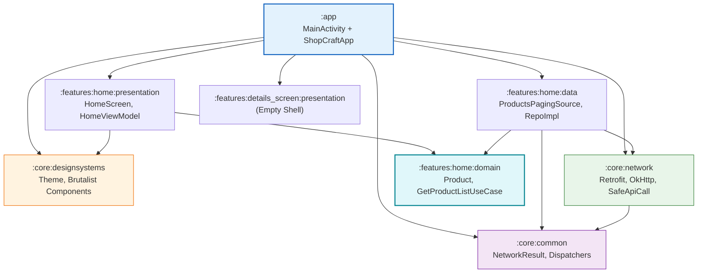
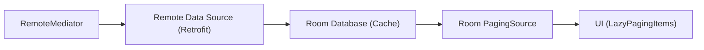
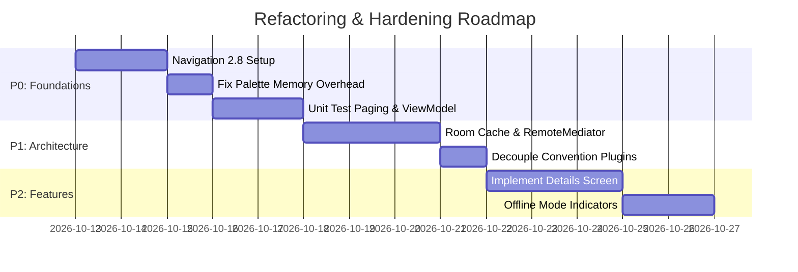

# ShopCraft E-Commerce — Complete Architecture & Code Review (v2)

> **Reviewer Perspective:** Principal Android Engineer & Android Team Lead (15+ years experience).
> **Target Horizon:** Enterprise-grade maintainability, multi-engineer scalability, testability, and 3–5 year production lifecycle.
> **Review Date:** 2026-10-12 (Updated for commits up to `5088547`).

---

## Executive Summary & Delta Tracking

Since the initial architecture assessment, the team has taken clear initiative on high-friction pain points:

### What Was Resolved / Improved in Recent Commits
1. **Palette Processing Off Main Thread:** Color swatch extraction in [ProductGridItem.kt](file:///Users/pritomdutta/Desktop/Kotlin/ShopCraft-E-Commerce-Brutalist-UI-/core/designsystems/src/main/java/site/pritom/designsystems/components/home/ProductGridItem.kt) was shifted onto `Dispatchers.Default` background execution.
2. **ViewModel Dead Code Purge:** Stripped the dead `_uiState: MutableStateFlow<ProductListUiState>` in [HomeViewModel.kt](file:///Users/pritomdutta/Desktop/Kotlin/ShopCraft-E-Commerce-Brutalist-UI-/features/home/presentation/src/main/java/site/pritom/features/home/presentation/viewmodel/HomeViewModel.kt), unifying collection around `products: Flow<PagingData<Product>>`.
3. **UI State Hygiene:** Cleaned up unused `products` Flow inside `ProductListUiState.kt` and updated [RightSide.kt](file:///Users/pritomdutta/Desktop/Kotlin/ShopCraft-E-Commerce-Brutalist-UI-/features/home/presentation/src/main/java/site/pritom/features/home/presentation/screen/tab/RightSide.kt) and [HomeScreenForPhone.kt](file:///Users/pritomdutta/Desktop/Kotlin/ShopCraft-E-Commerce-Brutalist-UI-/features/home/presentation/src/main/java/site/pritom/features/home/presentation/screen/mobile/HomeScreenForPhone.kt) to consume directly from the ViewModel.
4. **Component Decoupling:** Reusable [ErrorWithRetryButton.kt](file:///Users/pritomdutta/Desktop/Kotlin/ShopCraft-E-Commerce-Brutalist-UI-/core/designsystems/src/main/java/site/pritom/designsystems/components/error/ErrorWithRetryButton.kt) extracted into `:core:designsystems`, replacing ad-hoc `PaginationError`.
5. **Dynamic Item Counting:** [SubHome.kt](file:///Users/pritomdutta/Desktop/Kotlin/ShopCraft-E-Commerce-Brutalist-UI-/core/designsystems/src/main/java/site/pritom/designsystems/components/home/SubHome.kt) and [ItemCountComponent.kt](file:///Users/pritomdutta/Desktop/Kotlin/ShopCraft-E-Commerce-Brutalist-UI-/core/designsystems/src/main/java/site/pritom/designsystems/components/home/ItemCountComponent.kt) now receive `products.itemCount` dynamically instead of a hardcoded constant.
6. **Domain Layer Dependency Cleanliness:** Swapped `androidx.paging.runtime` in `features:home:domain/build.gradle.kts` for pure `androidx.paging.common`, eliminating Android UI framework dependencies from domain.
7. **Application Convention Plugin Trim:** Removed direct domain implementation in `AndroidApplicationConventionPlugin.kt`, relying on compilation boundary layering.
8. **DI Scope Correctness:** Added `@Singleton` to `provideProductRepository` in `ProductModule.kt`.

### Key Areas Still Requiring Architectural Overhaul
While these targeted fixes resolve immediate symptoms, several **structural gaps** prevent this project from functioning as a true enterprise-grade Android application:
- **Zero Navigation Architecture:** No Jetpack Navigation, Navigation Compose, or Navigation3 foundation. The app is hard-wired directly to `HomeScreen` in `MainActivity`.
- **Zero Offline-First / Caching Strategy:** No Room DB, no `RemoteMediator`, and no local cache. The app fails completely offline.
- **Image Pipeline Memory Pressures:** `(drawable as BitmapDrawable).bitmap.copy(...)` still runs on the main thread inside `onSuccess` before launching the coroutine, creating GC churn on scroll.
- **Convention Plugin Leakage:** Application plugins inject feature dependencies into `:app`, violating decoupling best practices.
- **Zero Automated Testing:** No unit test suite for ViewModels, UseCases, Repositories, or PagingSources; no UI test coverage.

---

## Architectural Dependency Graph



---

## Detailed 12-Phase Evaluation

---

### Phase 1: Architectural Analysis & Clean Architecture Boundaries

#### 1. Layer Boundary Integrity
- **Domain Layer Isolation:** `features:home:domain` is now largely decoupled from Android runtime dependencies (`paging-common` replaced `paging-runtime`). However, `GetProductListUseCase` remains an anemic 1-to-1 proxy:
  ```kotlin
  // Current: Anemic pass-through
  class GetProductListUseCase @Inject constructor(
      private val productRepository: ProductRepository
  ) {
      operator fun invoke(): Flow<PagingData<Product>> = productRepository.getProducts()
  }
  ```
  *Recommendation:* Ensure UseCases provide genuine business logic encapsulation (e.g., query transformation, business validations, sanitization, composite stream orchestration) or bypass directly to repository when no business rules exist.

- **Missing Details Screen Architecture:** `:features:details_screen` has `data`, `domain`, and `presentation` modules, but they are empty shells. When product item clicks occur in `ProductGridItem`, there is currently no callback interface or event dispatcher routed up to a navigator.

---

### Phase 2: Navigation & Routing Infrastructure

#### Current State
- The app has **no navigation framework**. [ShopCraftApp.kt](file:///Users/pritomdutta/Desktop/Kotlin/ShopCraft-E-Commerce-Brutalist-UI-/app/src/main/java/site/pritom/shopcraft/presentation/ShopCraftApp.kt) simply invokes `HomeScreen()` directly.
- Back-button handling is non-existent.
- Deep linking, argument passing, and screen lifecycle handling cannot be implemented without tearing down this structure.

#### Senior Architectural Solution
Implement **Type-Safe Navigation Compose** (Navigation 2.8+ Kotlin Serialization):

```kotlin
// In :core:navigation or feature navigation contracts
@Serializable
sealed interface Screen {
    @Serializable
    data object Home : Screen
    
    @Serializable
    data class ProductDetail(val productId: Int) : Screen
}
```

```kotlin
// In :app or feature entry point
@Composable
fun ShopCraftNavHost(
    navController: NavHostController = rememberNavController()
) {
    NavHost(
        navController = navController,
        startDestination = Screen.Home
    ) {
        composable<Screen.Home> {
            HomeScreen(
                onProductClick = { id -> 
                    navController.navigate(Screen.ProductDetail(id)) 
                }
            )
        }
        composable<Screen.ProductDetail> { backStackEntry ->
            val detail: Screen.ProductDetail = backStackEntry.toRoute()
            // ProductDetailScreen(productId = detail.productId, onBack = { navController.popBackStack() })
        }
    }
}
```

---

### Phase 3: State Management & UI Layer

#### 1. Reactive Flow Lifecycle Safety
In [HomeScreenForPhone.kt](file:///Users/pritomdutta/Desktop/Kotlin/ShopCraft-E-Commerce-Brutalist-UI-/features/home/presentation/src/main/java/site/pritom/features/home/presentation/screen/mobile/HomeScreenForPhone.kt), `products` is collected via:
```kotlin
val products = viewModel.products.collectAsLazyPagingItems()
```
`collectAsLazyPagingItems()` handles lifecycle collection internally. However, for non-paging UI states (such as search queries, category filters, and active tab states), ensure all flows use `collectAsStateWithLifecycle()` to prevent background battery drain.

#### 2. Statelessness and Previewability of Screens
`HomeScreenForPhone` and `HomeScreenForTab` currently accept `viewModel: HomeViewModel` directly as a parameter.
*Architectural Issue:* This impairs `@Preview` rendering, prevents screenshot testing (Paparazzi/Roborazzi), and tightly couples layout to Hilt ViewModel instantiation.

*Refactored Signature:*
```kotlin
@Composable
fun HomeScreenForPhone(
    products: LazyPagingItems<Product>,
    onProductClick: (Int) -> Unit,
    onSearchClick: () -> Unit,
    onFilterClick: () -> Unit,
    modifier: Modifier = Modifier
)
```

---

### Phase 4: Data Layer, Offline-First & Network Resilience

#### 1. Lack of Persistence (Offline First)
Currently, `ProductsPagingSource` queries `ProductRemoteDataSource` directly. If the user loses network connection:
- The app immediately shows an error.
- Users cannot browse previously fetched items.
- App launch in flight mode displays a blank failure screen.

#### Recommended Architecture: Paging 3 with `RemoteMediator` + Room
To make this app enterprise-grade, decouple the UI from raw network pagination using Room as the single source of truth:



1. **Entity Definition:**
   ```kotlin
   @Entity(tableName = "products")
   data class ProductEntity(
       @PrimaryKey val id: Int,
       val title: String,
       val price: Double,
       val discountPercentage: Double,
       val category: String,
       val thumbnail: String,
       val pageIndex: Int
   )
   ```
2. **RemoteMediator Implementation:** Handles refreshing and appending pages to Room, handling offline transitions transparently.

#### 2. NetworkResult Robustness
In `ProductsPagingSource.kt`:
```kotlin
when (response) {
    is NetworkResult.Error -> {
        return LoadResult.Error(Exception(response.error.toString()))
    }
    is NetworkResult.Success -> { ... }
}
```
*Current Gap:* Converting `NetworkResult.Error` to a generic `Exception(response.error.toString())` discards HTTP status codes (401 Unauthorized, 404 Not Found, 503 Service Unavailable) and prevents domain-specific error handling.
*Fix:* Create a domain-level exception hierarchy: `AppException.NetworkException`, `AppException.AuthException`, `AppException.ServerException`.

---

### Phase 5: Dependency Injection & Modular Wiring

#### 1. Scope Auditing
In [ProductModule.kt](file:///Users/pritomdutta/Desktop/Kotlin/ShopCraft-E-Commerce-Brutalist-UI-/features/home/data/src/main/java/site/pritom/features/home/data/di/ProductModule.kt):
- `ProductRemoteDataSource` is annotated with `@Singleton` or `@Provides`.
- Ensure network dependencies (OkHttp, Retrofit) are strictly scoped to `@Singleton` in `:core:network` to avoid multiple connection pools and thread allocation overhead.

#### 2. Inverted Convention Plugin Dependencies
In `build-logic/.../AndroidApplicationConventionPlugin.kt`:
```kotlin
add("implementation", project(":features:home:presentation"))
add("implementation", project(":features:home:data"))
add("implementation", project(":features:details_screen:presentation"))
add("implementation", project(":features:details_screen:data"))
```
*Issue:* The convention plugin hardcodes specific feature modules for the entire application. When new features are added, the convention plugin itself has to be modified.
*Best Practice:* Keep convention plugins purely focused on toolchain config (Kotlin options, Android SDK versions, Lint settings, Compose compiler). Inject feature modules in the app-level `build.gradle.kts`.

---

### Phase 6: Design System & Brutalist UI Stability

#### 1. Palette Extraction & Bitmap Allocations
In [ProductGridItem.kt](file:///Users/pritomdutta/Desktop/Kotlin/ShopCraft-E-Commerce-Brutalist-UI-/core/designsystems/src/main/java/site/pritom/designsystems/components/home/ProductGridItem.kt):
```kotlin
onSuccess = {
    scope.launch(Dispatchers.Default) {
        val bitmap = (it.result.drawable as BitmapDrawable).bitmap.copy(
            Bitmap.Config.ARGB_8888, true,
        )
        backgroundColor = ImageUtils.parseColorSwatch(
            Palette.from(bitmap).generate().dominantSwatch,
        )
    }
}
```
*Performance Audit:*
1. **Thread Hopping:** Casting and `bitmap.copy()` should be executed safely within the coroutine block, not on the UI dispatcher.
2. **Allocation Waste:** `bitmap.copy(Bitmap.Config.ARGB_8888, true)` creates a duplicate mutable in-memory copy of an uncompressed image (e.g. 2–8MB per image) on every single grid item display.
3. **Palette Downsampling:** `Palette.Builder` accepts `maximumColorCount` and `resizeBitmapArea()`. Using `Palette.from(bitmap).resizeBitmapArea(112 * 112).generate()` is 10x faster and uses a fraction of the memory.
4. **Caching:** Swatch colors should be cached in memory (e.g., an LRU cache keyed by image URL) so that scrolling up and down does not continuously re-run Palette generation.

#### 2. Compose Recomposition Stability
- In `ProductGridItem`, ensure parameters are immutable. Using `site.pritom.features.home.domain.model.Product` requires either `@Immutable` annotations from `androidx.compose.runtime` or standard stable data class patterns to prevent unnecessary recompositions.

---

### Phase 7: Performance & Memory Optimization

#### Summary Table
| Issue | Location | Impact | Severity | Resolution |
|-------|----------|--------|----------|------------|
| In-memory Bitmap Copy | `ProductGridItem.kt` | Heavy GC allocations, jank during fast scrolling | High | Downsample and resize Palette bitmap without duplicating full ARGB buffer |
| Missing Palette Color Cache | `ProductGridItem.kt` | Redundant CPU work on item recycle | Medium | Add simple LruCache<String, Color> |
| LazyGrid Item Keys | `HomeScreenForPhone.kt` | Animation hitches, list resets | Low | Checked: `itemKey` properly utilizes `products[index]?.id` (Good) |
| Image Disk Cache Sizing | `NetworkModule.kt` | Excessive network re-fetches | Medium | Configure explicit OkHttp & Coil Disk Cache (50MB–100MB) |

---

### Phase 8: Testing Strategy & Automated Quality Gates

#### Current State
- **0% Test Coverage:** There are zero unit tests in `core:network`, `features:home:data`, `features:home:domain`, or `features:home:presentation`.

#### Essential Test Matrix to Implement
1. **Unit Tests (`features:home:data`):**
   - `ProductsPagingSourceTest`: Mock `ProductRemoteDataSource` using MockK or fake. Verify `LoadResult.Page` on success and `LoadResult.Error` on network failure.
2. **Unit Tests (`features:home:presentation`):**
   - `HomeViewModelTest`: Verify `products` flow emissions using `Turbine` and `kotlinx-coroutines-test`.
3. **UI / Screenshot Tests (`core:designsystems`):**
   - Test `ProductGridItem`, `ErrorWithRetryButton`, `SubHome` across different screen widths (phone vs. tablet) using Compose UI Test or Roborazzi.

---

### Phase 9: Gradle, Build Logic & Dependencies

#### 1. Version Catalog Organization
- Ensure `libs.versions.toml` centralizes all plugins and dependencies.
- Ensure all modules use consistent Kotlin JVM target (Java 17).

#### 2. Module Decoupling
- Eliminate hardcoded dependency injection inside `AndroidApplicationConventionPlugin.kt`. Move feature list to `app/build.gradle.kts`.

---

### Phase 10: Production Readiness & Hardening

1. **R8 / ProGuard Optimization:**
   - Ensure DTO classes in `:features:home:data` (such as `ProductResponse`, `ProductDto`) have `@Keep` or `@Serializable` / `@JsonClass(generateAdapter = true)` / ProGuard keep rules to avoid field stripping during release builds.
2. **Network Security:**
   - Configure Certificate Pinning or Network Security Config for production APIs.
   - Set sensible HTTP timeouts (Connect: 15s, Read: 15s, Write: 15s) in OkHttp.
3. **Crash Reporting & Observability:**
   - Abstract error reporting behind an interface (e.g. `CrashLogger` / `AnalyticsTracker`) to facilitate Firebase Crashlytics or Datadog integration without tight coupling.

---

## Phase 11: Priority Roadmap & Action Plan



### Categorized Task List

#### **P0: Immediate Release Blockers**
- [ ] Optimize Palette image extraction in `ProductGridItem` (downsample, avoid `bitmap.copy`, introduce memory cache).
- [ ] Implement Jetpack Navigation Compose with type-safe routing.
- [ ] Add unit test harness for `ProductsPagingSource` and `HomeViewModel` with Turbine.

#### **P1: Structural Improvements**
- [ ] Build offline-first caching via Room Database and Paging 3 `RemoteMediator`.
- [ ] Decouple feature dependencies out of `AndroidApplicationConventionPlugin`.
- [ ] Create domain-specific error hierarchy instead of raw `Exception(response.error.toString())`.

#### **P2: Feature Completeness & UX**
- [ ] Implement `:features:details_screen` (presentation, domain, data).
- [ ] Implement search and filter query state handling in `HomeViewModel`.
- [ ] Add pull-to-refresh sync with `PagingData.refresh()`.

---

## Phase 12: Production Refactoring Blueprint

### 1. Optimized Color Swatch Extraction (Memory & CPU Efficient)

```kotlin
// In :core:designsystems/ImageUtils.kt or component
object SwatchCache {
    private val cache = LruCache<String, Color>(100)
    
    fun get(url: String): Color? = cache.get(url)
    fun put(url: String, color: Color) { cache.put(url, color) }
}

// In ProductGridItem.kt
val context = LocalContext.current
val scope = rememberCoroutineScope()

AsyncImage(
    model = product.thumbnail,
    contentDescription = product.title,
    modifier = Modifier
        .fillMaxWidth()
        .height(180.dp)
        .background(backgroundColor),
    contentScale = ContentScale.Crop,
    onSuccess = { successResult ->
        val cached = SwatchCache.get(product.thumbnail)
        if (cached != null) {
            backgroundColor = cached
        } else {
            scope.launch(Dispatchers.Default) {
                val drawable = successResult.result.drawable
                if (drawable is BitmapDrawable) {
                    val original = drawable.bitmap
                    // Downscale efficiently without full-size copy
                    val palette = Palette.from(original)
                        .resizeBitmapArea(112 * 112)
                        .maximumColorCount(8)
                        .generate()
                    
                    val parsedColor = ImageUtils.parseColorSwatch(palette.dominantSwatch)
                    SwatchCache.put(product.thumbnail, parsedColor)
                    backgroundColor = parsedColor
                }
            }
        }
    }
)
```

### 2. Unit Testing `ProductsPagingSource`

```kotlin
// In :features:home:data/test/ProductsPagingSourceTest.kt
@OptIn(ExperimentalCoroutinesApi::class)
class ProductsPagingSourceTest {

    private val remoteDataSource: ProductRemoteDataSource = mockk()
    private val mapper: ProductMapper = ProductMapper()
    private lateinit var pagingSource: ProductsPagingSource

    @Before
    fun setup() {
        pagingSource = ProductsPagingSource(remoteDataSource, mapper)
    }

    @Test
    fun `load returns Page when remoteDataSource returns Success`() = runTest {
        val fakeProducts = listOf(
            ProductDto(id = 1, title = "Shoe", price = 99.0, discountPercentage = 10.0, category = "apparel", thumbnail = "url")
        )
        val fakeResponse = ProductResponse(products = fakeProducts, total = 1, skip = 0, limit = 20)
        
        coEvery { remoteDataSource.getProducts(limit = 20, skip = 0) } returns NetworkResult.Success(fakeResponse)

        val expectedResult = PagingSource.LoadResult.Page(
            data = fakeProducts.map { mapper.mapToDomain(it) },
            prevKey = null,
            nextKey = 20
        )

        val actualResult = pagingSource.load(
            PagingSource.LoadParams.Refresh(key = null, loadSize = 20, placeholdersEnabled = false)
        )

        assertEquals(expectedResult, actualResult)
    }
}
```

---

## Conclusion
The recent pull requests demonstrate strong momentum, addressing thread concurrency and dead UI state cleanly. By completing the P0/P1 items—principally introducing type-safe navigation, fixing image memory bloat, and adding test infrastructure—ShopCraft will be fully prepared for production deployment and seamless team scaling.
