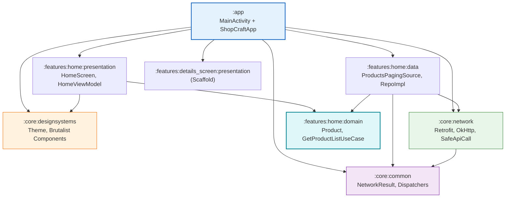
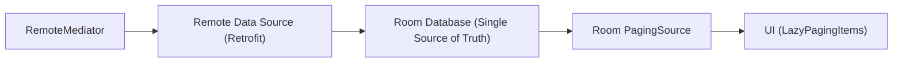
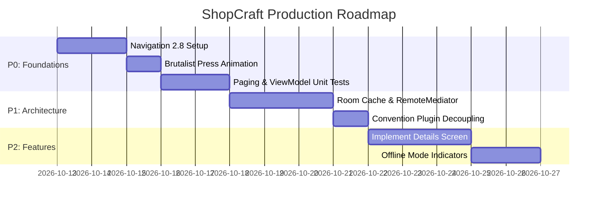

# ShopCraft E-Commerce — Comprehensive Codebase & Architecture Analysis

> **Author:** Principal Android Engineer & Technical Lead  
> **Date:** 2026-10-12  
> **Target:** Native Android Application (Jetpack Compose, Kotlin, Coroutines, Paging 3, Hilt, Retrofit, Material 3, Brutalist Design System)

---

## 1. Executive Assessment & Scorecard

| Domain | Rating | Current State | Production Target |
|:---|:---:|:---|:---|
| **Modular Architecture** | **8.0 / 10** | Clear separation of `:core:*` and feature modules (`:data`, `:domain`, `:presentation`). Pure Kotlin domain. | Clean dependency inversion without convention-plugin feature leakage. |
| **Build Configuration** | **8.5 / 10** | Custom convention plugins in `build-logic`, Gradle 9.8.0 compatibility, centralized Version Catalog (`libs.versions.toml`). | Decouple feature injections from application convention plugins. |
| **Design System & UI** | **7.5 / 10** | Strong visual identity (Brutalist style), adaptive layout for phone and tablet. Tactile click feedback added. | Eliminate coroutine timer click hacks, use `InteractionSource`, optimize Palette allocations. |
| **State Management** | **7.0 / 10** | Paging 3 Flow collected cleanly in UI. Dead states purged from ViewModel. | Hoist UI states cleanly for `@Preview` support and screenshot testing. |
| **Data & Offline Resilience**| **5.0 / 10** | Direct network pagination via `ProductsPagingSource`. Zero caching or offline support. | Offline-first architecture using **Room** + **Paging 3 `RemoteMediator`**. |
| **Navigation & Routing** | **2.0 / 10** | No navigation framework. Hardcoded single-screen invocation in `ShopCraftApp`. Empty details module. | Type-Safe Navigation Compose (Navigation 2.8+ Kotlin Serialization). |
| **Testing & Quality Gates** | **0.0 / 10** | **0% automated tests** across all modules (no unit, integration, or UI tests). | Minimum 80% test coverage across Domain, Data Mappers, and ViewModels. |

---

## 2. Multi-Module Architecture & Layer Boundaries



### Key Architectural Strengths
1. **Domain Layer Purity:** `features:home:domain` depends on `libs.androidx.paging.common` (pure Kotlin) rather than Android UI framework libraries (`paging.runtime`).
2. **Feature Isolation:** Features are segregated into standard Clean Architecture tiers (`data`, `domain`, `presentation`).
3. **DI Scoping:** Singleton scopes are properly applied to core network clients and repository bindings.

### Architectural Risks & Recommended Refactors
1. **Inverted Dependency in Convention Plugins:**
   In [AndroidApplicationConventionPlugin.kt](file:///Users/pritomdutta/Desktop/Kotlin/ShopCraft-E-Commerce-Brutalist-UI-/build-logic/src/main/kotlin/AndroidApplicationConventionPlugin.kt), the convention plugin adds dependencies to feature presentation and data modules:
   ```kotlin
   add("implementation", project(":features:home:presentation"))
   add("implementation", project(":features:home:data"))
   ```
   *Fix:* Build convention plugins should only handle build toolchains, SDK versions, and compiler options. Module dependencies should be declared in `app/build.gradle.kts`.
2. **Empty Module Overhead:**
   `:features:details_screen` contains three modules (`data`, `domain`, `presentation`) that are completely empty. They add build overhead without functionality.

---

## 3. UI Layer & Design System Deep Dive

### A. Tactile Press Animation in `CommonShodowBrutalist.kt`

#### Current Implementation Analysis
```kotlin
// In CommonShodowBrutalist.kt
var isClicked by remember { mutableStateOf(false) }
val scope = rememberCoroutineScope()
var resetJob by remember { mutableStateOf<Job?>(null) }
...
.clickable(enabled = enabled, indication = null, interactionSource = null) {
    isClicked = true
    resetJob?.cancel()
    resetJob = scope.launch {
        delay(220.milliseconds)
        isClicked = false
    }
    onClickItem()
}
```

#### Identified Issues:
1. **Arbitrary Delay Hack:** The animation runs *after* a click event fires, using a hardcoded `220.milliseconds` delay. It does not respond to touch down/up states.
2. **Missing Physical Translation:** Only the shadow offset animates from `3.dp` to `0.dp`. In physical brutalist design, the container itself must physically translate down-right into the shadow surface when pressed.
3. **Unnecessary Allocations on Static Elements:** Every `BrutalistContainer` throughout the app (including static text labels, headers, and badges where `enabled = false`) allocates coroutine scopes, job states, and animation drivers.
4. **Accessibility:** Using `indication = null` and `interactionSource = null` without custom semantics disables accessibility announcements and focus states.

#### Production Solution:
```kotlin
@Composable
fun BrutalistContainer(
    modifier: Modifier = Modifier,
    backgroundColor: Color = Color.White,
    borderColor: Color = Color.Black,
    shadowColor: Color = Color.Black,
    borderWidth: Dp = 2.dp,
    cornerRadius: Dp = 12.dp,
    shadowOffset: DpOffset = DpOffset(3.dp, 3.dp),
    contentPadding: PaddingValues = PaddingValues(0.dp),
    contentAlignment: Alignment = Alignment.Center,
    isShowShadow: Boolean = true,
    enabled: Boolean = false,
    onClickItem: () -> Unit = {},
    content: @Composable BoxScope.() -> Unit,
) {
    val shape = RoundedCornerShape(cornerRadius)

    val interactionSource = remember { MutableInteractionSource() }
    val isPressed by interactionSource.collectIsPressedAsState()

    // Animate smoothly between idle (1f) and pressed (0f)
    val shadowProgress by animateFloatAsState(
        targetValue = if (enabled && isPressed) 0f else 1f,
        animationSpec = spring(
            dampingRatio = Spring.DampingRatioMediumBouncy,
            stiffness = Spring.StiffnessLow,
        ),
        label = "brutalistPressAnimation",
    )

    val currentOffsetX = shadowOffset.x * shadowProgress
    val currentOffsetY = shadowOffset.y * shadowProgress

    // Physical button depression: move the container down-right as shadow collapses
    val translationX = shadowOffset.x * (1f - shadowProgress)
    val translationY = shadowOffset.y * (1f - shadowProgress)

    Box(
        modifier = modifier
            .offset(x = translationX, y = translationY)
            .drawBehind {
                if (isShowShadow) {
                    drawRoundRect(
                        color = shadowColor,
                        topLeft = Offset(currentOffsetX.toPx(), currentOffsetY.toPx()),
                        size = size,
                        cornerRadius = CornerRadius(cornerRadius.toPx()),
                    )
                }
            }
            .clip(shape)
            .background(backgroundColor)
            .border(width = borderWidth, color = borderColor, shape = shape)
            .then(
                if (enabled) {
                    Modifier.clickable(
                        interactionSource = interactionSource,
                        indication = null, // Custom physical translation provides the tactile feedback
                        onClick = onClickItem,
                    )
                } else Modifier
            )
            .padding(contentPadding),
        contentAlignment = contentAlignment,
        content = content,
    )
}
```

---

### B. Color Palette Extraction in `ProductGridItem.kt` & `ImageUtils.kt`

#### Current Status
- Color caching via `LruCache<String, Int>(200)` and downscaling with `.resizeBitmapArea(112 * 112)` have resolved the earlier main-thread freeze.
- Extraction runs asynchronously on background dispatchers.

#### Remaining Optimization Points
1. **Duplicate Network / Image Pipeline:** `AsyncImage` fetches the image for rendering, while `ImageUtils.getDominantColor` makes a second `imageLoader.execute(request)` call.
2. **1-Frame White Flash:** `backgroundColor` in `ProductGridItem` initializes to `initialColor` (`Color.White`), so items flicker white for one frame before the cache is queried in `LaunchedEffect`.
3. **Coil Decode Size:** Coil decodes the full-resolution bitmap into memory before Palette downsamples it.
4. **Color Selection:** Using `dominantSwatch` often creates dark or muddy backgrounds. `lightMutedSwatch` or `mutedSwatch` aligns much better with Brutalist aesthetics.

---

## 4. State Management & Presentation Layer

### Stateless Composables & Previewability
In [HomeScreenForPhone.kt](file:///Users/pritomdutta/Desktop/Kotlin/ShopCraft-E-Commerce-Brutalist-UI-/features/home/presentation/src/main/java/site/pritom/features/home/presentation/screen/mobile/HomeScreenForPhone.kt) and [RightSide.kt](file:///Users/pritomdutta/Desktop/Kotlin/ShopCraft-E-Commerce-Brutalist-UI-/features/home/presentation/src/main/java/site/pritom/features/home/presentation/screen/tab/RightSide.kt), `HomeViewModel` is passed directly into the top-level screen composable.

**Architectural Recommendation (State Hoisting):**
```kotlin
// 1. Stateful Route (Handles DI and Navigation)
@Composable
fun HomeRoute(
    viewModel: HomeViewModel = hiltViewModel(),
    onProductClick: (Int) -> Unit,
) {
    val products = viewModel.products.collectAsLazyPagingItems()
    HomeScreenForPhone(
        products = products,
        onProductClick = onProductClick,
    )
}

// 2. Stateless UI (Compatible with Previews and Screenshot Tests)
@Composable
fun HomeScreenForPhone(
    products: LazyPagingItems<Product>,
    onProductClick: (Int) -> Unit,
    modifier: Modifier = Modifier,
) {
    ...
}
```

### Stable LazyGrid Item Keys
`HomeScreenForPhone` uses composite keys with index:
```kotlin
key = { index -> "${products[index]?.id}_$index" }
```
When pages append or list items shift, string concatenation and index changes trigger unnecessary recompositions.  
Use the stable entity ID:
```kotlin
key = { index -> products[index]?.id ?: index }
```

---

## 5. Data Layer, Network & Offline Resilience

### 1. Offline-First Architecture
`ProductsPagingSource` currently queries `ProductRemoteDataSource` directly over HTTP. If network connectivity is lost, the screen displays an error and all loaded items are lost.

#### Proposed Room + RemoteMediator Architecture


1. Create a `:core:database` module with Room.
2. Store `ProductEntity` and `RemoteKeysEntity`.
3. Implement `ProductRemoteMediator` to fetch pages from the network and save them directly to Room.
4. Provide `Pager(config, remoteMediator = mediator) { productDao.pagingSource() }`.

### 2. Rich Network Error Categorization
In `safeApiCall.kt`:
```kotlin
return when (e) {
    is HttpException -> NetworkResult.Error(NetworkError.SERVER_ERROR)
    is IOException -> NetworkResult.Error(NetworkError.NO_INTERNET)
    else -> NetworkResult.Error(NetworkError.UNKNOWN)
}
```
HTTP status codes (401, 403, 404, 429, 503) are collapsed into `SERVER_ERROR`. The error model should carry the HTTP status code and server response message so the presentation layer can present actionable error states (e.g., Session Expired vs. Server Maintenance).

---

## 6. Navigation Architecture

### Current Status
- No navigation framework exists. [ShopCraftApp.kt](file:///Users/pritomdutta/Desktop/Kotlin/ShopCraft-E-Commerce-Brutalist-UI-/app/src/main/java/site/pritom/shopcraft/presentation/ShopCraftApp.kt) simply invokes `HomeScreen()` directly.
- Item clicks in `ProductGridItem` cannot navigate anywhere.
- No backstack handling, no deep linking.

### Recommended Implementation (Navigation Compose 2.8+ Type-Safe Destinations)
```kotlin
// Navigation Destinations
@Serializable
sealed interface NavDestination {
    @Serializable
    data object Home : NavDestination

    @Serializable
    data class ProductDetail(val productId: Int) : NavDestination
}

// App Navigation Host
@Composable
fun ShopCraftNavHost(
    navController: NavHostController = rememberNavController(),
) {
    NavHost(
        navController = navController,
        startDestination = NavDestination.Home,
    ) {
        composable<NavDestination.Home> {
            HomeRoute(
                onProductClick = { productId ->
                    navController.navigate(NavDestination.ProductDetail(productId))
                }
            )
        }
        composable<NavDestination.ProductDetail> { backStackEntry ->
            val detail: NavDestination.ProductDetail = backStackEntry.toRoute()
            ProductDetailRoute(
                productId = detail.productId,
                onBackClick = { navController.popBackStack() },
            )
        }
    }
}
```

---

## 7. Quality Gates & Testing Strategy

Currently, there are **0 unit tests** in the codebase. To make this production-ready for an enterprise team:

1. **Unit Tests for `ProductsPagingSource`:**
   - Verify `LoadResult.Page` is returned with correct `prevKey` and `nextKey`.
   - Verify `LoadResult.Error` is returned when network fails.
2. **Unit Tests for `HomeViewModel`:**
   - Test flow emissions using `Turbine` and `StandardTestDispatcher`.
3. **Screenshot Testing:**
   - Add Roborazzi / Paparazzi tests for `BrutalistContainer`, `ProductGridItem`, and `ErrorWithRetryButton` to catch visual regressions across phone and tablet densities.

---

## 8. Prioritized Execution Roadmap



### Checklist

- [ ] **P0:** Refactor `BrutalistContainer` to use `MutableInteractionSource` + `isPressed` translation.
- [ ] **P0:** Set up Type-Safe Jetpack Navigation Compose.
- [ ] **P0:** Set up test dependencies (MockK, Turbine, coroutines-test) and add unit tests for `ProductsPagingSource` and `HomeViewModel`.
- [ ] **P1:** Implement Room database and `RemoteMediator` for offline-first support.
- [ ] **P1:** Remove feature dependencies from `AndroidApplicationConventionPlugin`.
- [ ] **P2:** Build out `:features:details_screen` (presentation, domain, and data).
